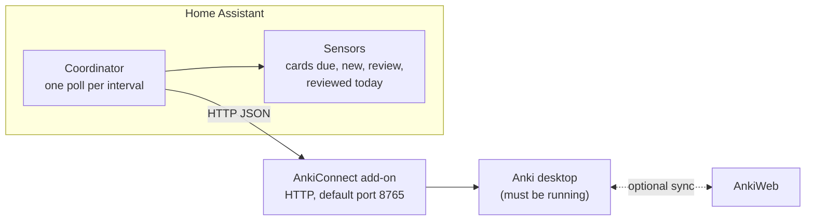
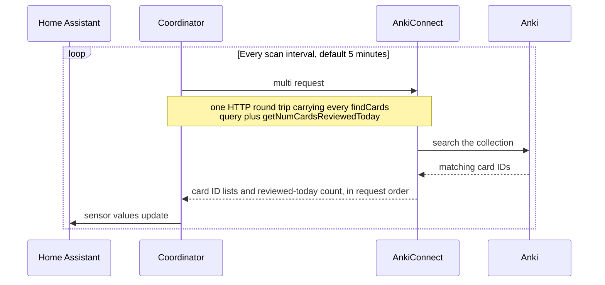

[](https://github.com/nikosavola/ha-anki/actions/workflows/test.yml)
[](https://github.com/nikosavola/ha-anki/actions/workflows/e2e.yml)
[](https://github.com/nikosavola/ha-anki/actions/workflows/validate.yml)
[](https://codecov.io/gh/nikosavola/ha-anki)
[](https://sonarcloud.io/summary/new_code?id=nikosavola_ha-anki)
[](LICENSE)
[](https://github.com/nikosavola/ha-anki/releases)

______________________________________________________________________

Home Assistant custom integration that exposes [Anki](https://apps.ankiweb.net/) card
counts as sensors, via the [AnkiConnect](https://ankiweb.net/shared/info/2055492159)
add-on. Anki must be running with AnkiConnect installed and reachable over the local
network; this integration only polls its local HTTP API, it doesn't talk to AnkiWeb.

## Quick start

These steps cover the common case, with Anki open on your desktop.

1. In Anki, go to **Tools > Add-ons > Get Add-ons**, and paste the code `2055492159` (AnkiConnect).

1. Go to **Tools > Add-ons**, select **AnkiConnect**, and click **Config**. Change `"webBindAddress"` from `"127.0.0.1"` to `"0.0.0.0"`, then save and restart Anki. This is what lets Home Assistant reach Anki from another computer. Only do this on a network you trust, and firewall port `8765` so that only your Home Assistant host can reach it. See [Known limitations](#known-limitations) for more.

   You can skip this step if Home Assistant runs directly on the same computer as Anki. Home Assistant in a VM or a Docker container usually can't reach `127.0.0.1` on that computer, so it still needs this step.

1. Install the integration from HACS:

   [](https://my.home-assistant.io/redirect/hacs_repository/?owner=nikosavola&repository=ha-anki&category=integration)

   Restart Home Assistant. Then go to **Settings > Devices & services > Add integration**, pick **ha-anki**, and enter the IP address of the computer running Anki as the **Host**. The port defaults to `8765`.

Anki needs to stay open for the sensors to update. For an always-on setup, see the [headless server guide](https://github.com/nikosavola/ha-anki/blob/main/docs/headless.md).

## How it works

AnkiConnect is an Anki add-on that exposes a local HTTP API; this integration is primarily a
polling client for it. Everything runs on your own network, and Anki itself has to be
running for any of it to answer.



The only path that leaves your network is Anki's own AnkiWeb sync. This integration can ask
Anki to trigger it (see [Poll and auto-sync intervals](#poll-and-auto-sync-intervals)), but
it never talks to AnkiWeb itself.

## Installation

### HACS

Use the badge in the [Quick start](#quick-start), or search for **ha-anki** in HACS, then
download it and restart Home Assistant.

### Manual

Copy `custom_components/ha_anki` into your Home Assistant `config/custom_components`
directory and restart Home Assistant.

## Configuration

The [Quick start](#quick-start) covers adding the integration. Home Assistant polls
AnkiConnect every 5 minutes. It does not fetch on demand, so multiple sensors never
generate duplicate requests.

### Poll and auto-sync intervals

From **Settings > Devices & services > ha-anki > Configure > set_interval** you can
adjust two independent intervals, both in minutes:

- **Scan interval**: how often Home Assistant polls AnkiConnect for sensor state
  (card counts, reviewed today). Defaults to 5 minutes; this only reads from
  AnkiConnect's local collection, it never talks to AnkiWeb.
- **Auto-sync interval**: how often this integration asks AnkiConnect to sync the
  Anki collection with AnkiWeb (the same action as Anki's own sync button), then
  refreshes sensor state. Set to `0` (the default) to disable it entirely and rely
  on the manual `ha_anki.sync` service, or on Anki's own sync on open/close.

A sync slower than its own interval is never run twice concurrently: a still-running
sync makes the next scheduled tick a no-op instead of overlapping it. If you already
sync AnkiWeb outside Home Assistant, e.g. via the systemd timer in step 6 of the
[headless server guide](https://github.com/nikosavola/ha-anki/blob/main/docs/headless.md#6-sync-to-ankiweb-periodically-in-the-background),
leave this at `0` so the two don't fight over the same sync.

## Supported functionality

One config entry polls AnkiConnect once per interval, batched into a single
`multi` request, and exposes four sensors:

| Sensor         | AnkiConnect action             |
| -------------- | ------------------------------ |
| Cards due      | `findCards`, query `is:due`    |
| New cards      | `findCards`, query `is:new`    |
| Review cards   | `findCards`, query `is:review` |
| Reviewed today | `getNumCardsReviewedToday`     |

All of it rides in that one `multi` request, so adding sensors never adds polling overhead:



### Custom query sensors

Beyond those four, you can add a sensor for any AnkiConnect search query from
**Settings > Devices & services > ha-anki > Configure**. It's the same
query syntax as Anki's own card browser, documented in full at
[docs.ankiweb.net/searching.html](https://docs.ankiweb.net/searching.html);
AnkiConnect just runs it through `findCards` and counts the results, the same
as the built-in sensors above. Each custom query becomes its own sensor,
polled and batched alongside the built-in four, and can be removed later from
the same Configure dialog.

A query is scoped to a deck, tag, or anything else Anki's search supports by
combining terms, for example:

| Name        | Query                 |
| ----------- | --------------------- |
| Spanish due | `deck:Spanish is:due` |
| Leeches     | `tag:leech`           |
| Suspended   | `is:suspended`        |
| Added today | `added:1`             |

### Services

- `ha_anki.sync`, targeted at any one of this integration's sensors, asks
  AnkiConnect to sync with AnkiWeb, then immediately refreshes sensor state
  instead of waiting for the next poll. It's an entity service, so target
  exactly one sensor; targeting several (or a whole device) runs it once per
  targeted entity.

- `ha_anki.add_note` creates a new note via AnkiConnect's
  [`addNote`](https://git.sr.ht/~foosoft/anki-connect#codeaddnotecode) action
  (see the [supported actions](https://git.sr.ht/~foosoft/anki-connect#supported-actions)
  list on that same page for the full reference, including note types,
  fields, and duplicate handling), then refreshes sensor state and returns
  the new note's ID as `{"note_id": ...}`. Unlike `sync`, it's a plain action
  picking the AnkiConnect instance via a `config_entry_id` field instead of
  an entity target, since it mutates the collection and must run exactly
  once per call. Combined with Home Assistant's
  [AI Task](https://www.home-assistant.io/integrations/ai_task/) structured
  data generation, this turns arbitrary text into a flashcard automatically:

  ```yaml
  sequence:
    - action: ai_task.generate_data
      data:
        task_name: "Anki flashcard"
        instructions: >-
          Turn this into a concise Anki flashcard, front and back:
          "Mitochondria are the powerhouse of the cell."
        structure:
          front:
            selector:
              text:
            description: The flashcard's front (question) side.
          back:
            selector:
              text:
            description: The flashcard's back (answer) side.
      response_variable: flashcard
    - action: ha_anki.add_note
      data:
        config_entry_id: <pick the AnkiConnect entry in the UI>
        deck_name: Default
        model_name: Basic
        fields:
          Front: "{{ flashcard.data.front }}"
          Back: "{{ flashcard.data.back }}"
  ```

  ```mermaid
  sequenceDiagram
      participant Script as Script or automation
      participant AI as ai_task.generate_data
      participant S as ha_anki.add_note
      participant AC as AnkiConnect

      Script->>AI: free text
      AI-->>Script: front and back
      Script->>S: config_entry_id, deck, model, fields
      S->>AC: addNote
      AC-->>S: note_id
      S->>AC: refresh (another multi poll)
      AC-->>S: fresh sensor values
  ```

  Wire that sequence into a script or automation, e.g. triggered by a voice
  assistant intent or a note-taking shortcut, so a snippet of text becomes a
  card without opening Anki.

## Known limitations

- **Local network only.** AnkiConnect has no authentication beyond an optional origin
  allowlist, so only point this integration at an AnkiConnect instance on a network you
  trust.
- **Anki must be running.** AnkiConnect is an Anki add-on, not a standalone service; if
  Anki is closed, the sensors go unavailable until it's reopened.

## Testing

`uv run --dev pytest` runs the regular unit test suite, which mocks
AnkiConnect's HTTP responses. There's also an end-to-end suite that runs the
integration against a real, disposable Anki + AnkiConnect instance instead,
including how to run the `e2e` GitHub Actions workflow locally with
[`act`](https://github.com/nektos/act) before pushing. See
[CONTRIBUTING.md](CONTRIBUTING.md#testing) for both.

## Contributing

See [CONTRIBUTING.md](CONTRIBUTING.md) for development setup and guidelines, and
[CODE_OF_CONDUCT.md](CODE_OF_CONDUCT.md) for community expectations. Found a
security issue? See [SECURITY.md](SECURITY.md) instead of opening a public issue.

## Versioning

Version numbers follow [ZeroVer](https://0ver.org/): the major version stays at 0
indefinitely, so a 0.y bump can carry breaking changes.
