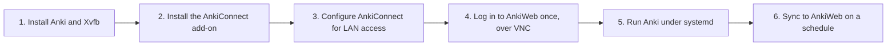
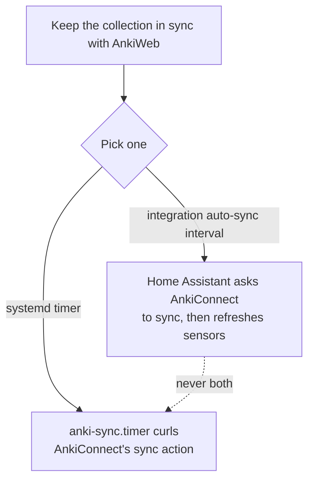

# Running Anki on a headless server

This integration polls a running Anki desktop process through AnkiConnect; it doesn't run
Anki itself. If you don't already have Anki open on a machine on your network, this guide
covers running it unattended on a Linux server: no monitor, no login session, syncing to
AnkiWeb on its own. "Headless" here means "running against a virtual display", since Anki is
a desktop (Qt) app with no dedicated headless mode.

On Home Assistant OS, the [Anki app](https://github.com/nikosavola/ha-anki-app) does all of this for you. Elsewhere, Docker is the quickest route, so it comes first. If you want fine-grained control over the
systemd units, skip ahead to [Manual setup with systemd](#manual-setup-with-systemd).

## Docker

Community Docker images bundle Anki, a virtual display, and AnkiConnect together, trading
some control over the setup for a single `docker run`:

```bash
docker run -d \
  -p 8765:8765 \
  -v anki-data:/data \
  thisisnttheway/headless-anki:latest
```

This is [`thisisnttheway/headless-anki`](https://github.com/ThisIsntTheWay/headless-anki);
[`ankimcp/headless-anki`](https://github.com/ankimcp/headless-anki) is a similar alternative.
`-v anki-data:/data` persists the Anki profile, and once logged in, the AnkiWeb auth token,
across container restarts and recreations; without it, every recreation starts from the
image's barebones default profile again.

The firewalling advice in [step 3](#3-configure-ankiconnect-for-lan-access) still applies to the container's published `8765`.

### Authentication

This image has no environment variable for AnkiWeb credentials: logging in works exactly like
[step 4](#4-log-in-to-ankiweb-once-interactively), just over the image's own built-in VNC server instead of a throwaway one. By
default it runs Anki under `QT_QPA_PLATFORM=vnc`, listening on port `5900`.

1. Add `-p 5900:5900` to the `docker run` above. To keep it private, bind it to `127.0.0.1`
   and SSH-tunnel in, the same way as step 4.
1. Connect a VNC client to `<host>:5900`, log in from Anki's **Sync** menu, and let the
   initial sync finish.
1. The auth token is now cached in `/data`, kept by the `anki-data` volume. Stop publishing
   `5900` if you only opened it for this.

AnkiConnect on port `8765` and the [`ha_anki.sync`](../README.md#services) service work the same
from here, since it's the same Anki + AnkiConnect stack underneath.

If you bring your own existing profile instead (`-v ~/.local/share/Anki2:/data`), its
AnkiConnect config may still be bound to `localhost` or have a restrictive CORS list from
desktop use: add `-e ANKICONNECT_WILDCARD_ORIGIN=1` to reset `webCorsOriginList` to `["*"]`
(the image backs up your existing `config.json` first), and check `webBindAddress` as in [step 3](#3-configure-ankiconnect-for-lan-access).

## Manual setup with systemd

### Overview



### 1. Install Anki and Xvfb

```bash
sudo apt update
sudo apt install xvfb libxkbcommon-x11-0 libxcb-cursor0 libxcb-icccm4 \
  libxcb-image0 libxcb-keysyms1 libxcb-randr0 libxcb-render-util0 \
  libxcb-xinerama0
```

A system Anki package is often outdated; the
[official Linux install script](https://docs.ankiweb.net/platform/linux/installing.html)
installs the latest release to `/usr/local/bin/anki`. Releases are published per
architecture (`anki-<version>-linux-x86_64.tar.zst` or `-aarch64.tar.zst`, e.g. on a
Raspberry Pi), so resolve the right asset instead of hardcoding a filename:

```bash
arch=$(uname -m)
asset=$(curl -s https://api.github.com/repos/ankitects/anki/releases/latest \
  | grep -o "anki-[0-9.]*-linux-${arch}\.tar\.zst" | head -1)
curl -LO "https://github.com/ankitects/anki/releases/latest/download/${asset}"
tar --zstd -xf "$asset"
cd anki-*
sudo ./install.sh
```

If your architecture isn't `x86_64`, check first that Anki even publishes a compatible
build: as of this writing, Anki's aarch64 release needs glibc 2.39+, which recent
Debian/Ubuntu have but Debian 12 "bookworm"-based systems (including current Raspberry Pi
OS and DietPi) don't. `ldd --version` shows what you have. If it's too old, pin an older
`aqt`/`anki` release built against an older PyQt6 (see
[this issue](https://github.com/ankitects/anki/issues/4167)) instead of the packaged
binary:

```bash
sudo -u anki python3 -m venv /var/lib/anki/venv
sudo -u anki /var/lib/anki/venv/bin/pip install \
  anki==24.11 "aqt[qt6]==24.11" \
  PyQt6==6.7.1 PyQt6-Qt6==6.7.3 PyQt6-WebEngine==6.7.0 PyQt6-WebEngine-Qt6==6.7.3
```

That installs an `anki` launcher into the venv's `bin/`; use
`/var/lib/anki/venv/bin/anki` in place of `/usr/local/bin/anki` in step 5 below. You may
also need a few runtime libraries the wheels expect that your distro ships under a newer
soname (for example `libwebp.so.6`/`libtiff.so.5` on bookworm, symlinked to the installed
`libwebp.so.7`/`libtiff.so.6`); install what `ldd` on
`.../PyQt6/Qt6/lib/libQt6WebEngineCore.so.6` reports missing.

Then create a dedicated, unprivileged user to run it as:

```bash
sudo useradd --system --create-home --home-dir /var/lib/anki --shell /usr/sbin/nologin anki
```

### 2. Install the AnkiConnect add-on

AnkiConnect is add-on code [2055492159](https://ankiweb.net/shared/info/2055492159). Since
it's just Python source, place it directly without ever opening a GUI. The add-on itself
lives in the repository's `plugin/` subdirectory, not the repository root, so clone
somewhere temporary first and copy that subdirectory into place:

```bash
sudo -u anki mkdir -p /var/lib/anki/.local/share/Anki2/addons21
sudo -u anki git clone --branch 25.11.9.0 --depth 1 \
  https://git.sr.ht/~foosoft/anki-connect /tmp/anki-connect-src
sudo -u anki cp -r /tmp/anki-connect-src/plugin \
  /var/lib/anki/.local/share/Anki2/addons21/2055492159
sudo rm -rf /tmp/anki-connect-src
```

Pin a tag rather than tracking the branch: AnkiConnect's `main` branch is developed
against whatever Python version current Anki bundles, which can be newer than what your
Anki install actually uses (a syntax error importing the add-on, rather than a runtime
error, is the symptom). `25.11.9.0` is the tag this project's own end-to-end tests pin;
newer tags should work too as long as your Anki meets the tag's own minimum version check
in its `__init__.py`.

You can also install it from the GUI instead. Use **Tools > Add-ons > Get Add-ons** during the
VNC session in step 4.

### 3. Configure AnkiConnect for LAN access

By default AnkiConnect binds to `127.0.0.1`, so nothing off the machine, including Home
Assistant, can reach it. Edit (or create)
`/var/lib/anki/.local/share/Anki2/addons21/2055492159/config.json`:

```json
{
  "apiKey": null,
  "apiLogPath": null,
  "webBindAddress": "0.0.0.0",
  "webBindPort": 8765,
  "webCorsOriginList": ["http://localhost"],
  "ignoreOriginList": []
}
```

`webBindAddress: 0.0.0.0` makes the port reachable from other hosts. There is no built-in
access control beyond `webCorsOriginList` (which only affects browser-originated requests, not
this integration's server-side ones) and the optional `apiKey`, so firewall the port to only
the Home Assistant host and don't expose it to the internet or an untrusted VLAN:

```bash
sudo ufw allow from <home-assistant-ip> to any port 8765 proto tcp
```

This matches the [Known limitations](../README.md#known-limitations) note.

### 4. Log in to AnkiWeb once, interactively

AnkiConnect's `sync` action just calls Anki's normal sync, which needs an AnkiWeb account
already configured in the profile. That login only has to happen once: Anki caches the auth
token in the profile afterward, so later syncs, including ones triggered headlessly over the
API, don't prompt again. Do it over a temporary VNC session:

```bash
sudo apt install tigervnc-standalone-server openbox
sudo -u anki bash -c '
  vncserver :1 -geometry 1280x1024 -localhost yes
  DISPLAY=:1 openbox &
  DISPLAY=:1 anki &
'
```

SSH-tunnel to it (`ssh -L 5901:localhost:5901 your-server`), connect a VNC client to
`localhost:5901`, log in from Anki's **Sync** menu, and let the initial sync finish. Then close
Anki, kill the VNC server (`vncserver -kill :1`), and remove `tigervnc-standalone-server` and
`openbox`; they're only needed for this one-time login.

If you set up systemd (step 5) before doing this, or need to log in again later (e.g. after
changing your AnkiWeb password), it's simpler to share the already-running `xvfb-anki.service`
display instead of starting a separate one: `sudo apt install x11vnc`, then
`sudo -u anki x11vnc -display :99 -localhost -nopw -forever` and tunnel to port `5900` the
same way. Stop it (`Ctrl+C`, or `sudo pkill x11vnc`) once you're done logging in.

### 5. Run Anki under systemd

Two units, so systemd tracks the virtual display alongside Anki instead of it being an
untracked background process:

```ini
# /etc/systemd/system/xvfb-anki.service
[Unit]
Description=Virtual display for headless Anki

[Service]
User=anki
Group=anki
ExecStart=/usr/bin/Xvfb :99 -screen 0 1280x1024x24 -nolisten tcp

[Install]
WantedBy=multi-user.target
```

```ini
# /etc/systemd/system/anki.service
[Unit]
Description=Anki (headless, for AnkiConnect)
After=network-online.target xvfb-anki.service
Requires=xvfb-anki.service
Wants=network-online.target

[Service]
User=anki
Group=anki
Environment=HOME=/var/lib/anki
Environment=DISPLAY=:99
ExecStart=/usr/local/bin/anki -b /var/lib/anki/.local/share/Anki2
Restart=on-failure
RestartSec=5

[Install]
WantedBy=multi-user.target
```

```bash
sudo systemctl daemon-reload
sudo systemctl enable --now xvfb-anki.service anki.service
```

Confirm AnkiConnect answers, from the Home Assistant host:

```bash
curl -s http://<anki-server-ip>:8765 -X POST -d '{"action": "version", "version": 6}'
# {"result": 6, "error": null}
```

If that hangs or refuses, check the firewall rule from step 3 and `sudo journalctl -u anki.service` for startup errors (a missing Qt xcb dependency shows up here as "could not
load the Qt platform plugin"). A lighter alternative to Xvfb is
`Environment=QT_QPA_PLATFORM=offscreen` on `anki.service`, dropping `xvfb-anki.service`
entirely, but it's less exercised for long-running Anki processes; fall back to Xvfb if
dialogs or first-run flows behave oddly.

### 6. Sync to AnkiWeb periodically in the background

Anki normally syncs on open/close, which never happens for a service that just keeps running.
Trigger it on a schedule instead. This integration can do that for you: set the
**auto-sync interval** described in
[Poll and auto-sync intervals](../README.md#poll-and-auto-sync-intervals), no systemd timer
required. The timer below is the OS-level alternative, useful if you want AnkiWeb sync to
keep running independently of Home Assistant; don't run both against the same Anki
instance, since the two would fight over who's syncing when. It works by calling
AnkiConnect's own `sync` action on a schedule:



```ini
# /etc/systemd/system/anki-sync.service
[Unit]
Description=Trigger an AnkiConnect sync to AnkiWeb

[Service]
Type=oneshot
ExecStart=/usr/bin/curl -sf -X POST http://localhost:8765 \
  -d '{"action": "sync", "version": 6}'
```

```ini
# /etc/systemd/system/anki-sync.timer
[Unit]
Description=Periodically trigger an AnkiConnect sync

[Timer]
OnBootSec=5min
OnUnitActiveSec=30min
Persistent=true

[Install]
WantedBy=timers.target
```

```bash
sudo systemctl daemon-reload
sudo systemctl enable --now anki-sync.timer
```

Adjust `OnUnitActiveSec` to taste: 30 minutes keeps due/new counts reasonably fresh without
syncing on every review. `sync` briefly blocks the collection while it runs, so don't set this
shorter than AnkiConnect's own polling in Home Assistant (5 minutes).
